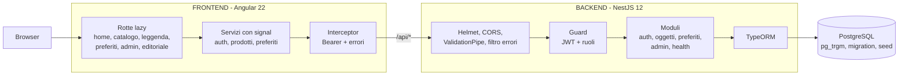

# ARCHIVIO 00

**Vintage menswear. Modern attitude.**

E-commerce di abbigliamento vintage anni Duemila, costruito con Angular 22, NestJS 12 e PostgreSQL.

`Angular 22` · `NestJS 12` · `PostgreSQL + TypeORM` · `Tailwind CSS 4` · `TypeScript` · `Vitest` · `Playwright`

> **Online:** https://archivio00.onrender.com · API: https://archivio00-api.onrender.com/health
> Gira sul piano gratuito di Render: dopo un po' di inattività l'API va in sleep e la prima visita può impiegare circa un minuto. Sul sito online non ci sono account demo né amministratore: chi vuole può registrarsi e usare i preferiti.

## Indice

1. [Cos'è ARCHIVIO 00 e la visione](#1-cosè-archivio-00-e-la-visione)
2. [L'identità: un'anima per ogni capo e ogni foto](#2-lidentità-unanima-per-ogni-capo-e-ogni-foto)
3. [Cosa mi è piaciuto costruire](#3-cosa-mi-è-piaciuto-costruire)
4. [Decisioni prese e perché](#4-decisioni-prese-e-perché)
5. [Sicurezza](#5-sicurezza)
6. [Architettura](#6-architettura)
7. [Funzionalità](#7-funzionalità)
8. [Avvio locale, variabili d'ambiente e test](#8-avvio-locale-variabili-dambiente-e-test)
9. [Deploy su Render, limiti noti e prossimi passi](#9-deploy-su-render-limiti-noti-e-prossimi-passi)
10. [Mappa dei file da leggere](#10-mappa-dei-file-da-leggere)

---

## 1. Cos'è ARCHIVIO 00 e la visione

ARCHIVIO 00 è un negozio online di capi vintage maschili: denim a vita bassa, giacche in pelle, tute in velour, piumini metallizzati, sneakers dei primi Duemila. Il catalogo di partenza conta 28 capi in sette categorie (Denim, Pelle, Top & Camicie, Trackwear, Outerwear, Pantaloni, Scarpe), da *Beckham Baggy Denim Collab* a *Adidas Climacool 2000 Archive*.

La domanda da cui sono partito non era «come si vende un capo online», ma «come si fa a far venire voglia di entrare in un archivio». Un catalogo di schede tutte uguali (foto, prezzo, bottone) non racconta niente. Volevo che chi arriva potesse perdersi: scegliere una leggenda, leggere perché quel modo di vestirsi funzionava, e solo dopo trovare i capi che gli somigliano.

Il motto sta nel manifesto della home: **«Nato adesso, cresciuto allora.»** e, subito sotto, **GOOD STYLE. SECOND LIFE.** Non serve inventarsi un'altra epoca, basta ridare vita a quella giusta.

Dal punto di vista tecnico è un'applicazione a due parti:

- **FRONTEND/**: Angular 22, interamente standalone, con stato a signal e rotte caricate in lazy.
- **BACKEND/**: API REST NestJS 12 con PostgreSQL e TypeORM, autenticazione JWT e ruoli.

## 2. L'identità: un'anima per ogni capo e ogni foto

Qui è dove ho messo più tempo. Tutto ciò che segue esiste nel codice e nei file del repository.

### Le tre leggende

L'home propone di «scegliere il suo stile»: tre figure degli anni Duemila, ciascuna con una pagina dedicata (`/leggenda/:slug`, dati in `FRONTEND/src/app/data/leggende.ts`). Ognuna ha un soprannome, un numero di maglia, un claim, un testo in tre paragrafi, tre regole di stile e una firma.

| Leggenda | Soprannome | Claim | Firma |
| --- | --- | --- | --- |
| Ronaldinho (10) | Il sorriso | «Se non ti diverti, hai già perso.» | *Jogo bonito* |
| Cristiano Ronaldo (07) | Il lavoro | «Nessuno si è mai svegliato leggenda per caso.» | *Siuuu* |
| Lionel Messi | Il silenzio | «Parlare poco. Poi andarsene in porta.» | *Tranquilo* |

Le regole sono piccole dichiarazioni di carattere. Per Ronaldinho: *«Il tessuto deve essere morbido o non lo metti»*, *«Se ti impedisce di ballare, non è roba tua»*. Per Cristiano: *«Se non si nota, cambialo»*, *«Le scarpe pulite non sono negoziabili»*. Ogni leggenda «rivendica» un gruppo di capi (campo `capi`): Ronaldinho i velour, le grafiche e i denim lavati; Cristiano la pelle e il puffer metallizzato; Messi i capi comodi e puliti come *carpenter-denim* e *wind-shell*. La pagina carica dal server solo quei capi, filtrando per chiave.

### Una scheda per ogni capo

Ogni capo ha una scheda scritta a mano in `FRONTEND/src/app/data/descrizioni.ts`, indicizzata sul nome del file immagine. Non descrivono la taglia: raccontano il capo.

- *Metallic Puffer*: «Nylon metallizzato che riflette qualunque cosa gli passi vicino… Nei primi Duemila brillare era un progetto, non un incidente.»
- *Acid Denim*: «Lavaggio acido con marmorizzazione irregolare — nessun pezzo è identico a un altro. Il denim che parlava più forte di chi lo indossava.»
- *Pirlo Corduroy*: «Eleganza senza sforzo apparente, che è sempre la cosa più difficile da ottenere.»

La scheda è legata alla foto e non al nome del capo perché un admin può rinominare un prodotto dal pannello, mentre la foto resta quella.

### Il diario

La pagina `/editoriale` («La cultura») è un diario fotografico di 10 scatti, in `FRONTEND/src/app/data/culture.ts`. Ogni scatto ha luogo, titolo, testo e, a volte, una firma. L'ordine è quello del racconto, non quello cronologico. Alcuni titoli: *«Prima veniva il sorriso»*, *«Il baile non finiva mai»*, *«Il lusso era il secondo joypad»* (una cameretta, tre ragazzi, Pro Evolution Soccer, la data 14 ottobre 2007), *«Zampa larga e trolley»*. Il testo della home sul diario dice: «Foto trovate, mosse, rovinate. Le teniamo così come sono.»

Accanto al diario c'è il **nastro**, una banda di 5 immagini con didascalia intitolata «L'ARIA CHE TIRAVA», che dà il tono fra il catalogo e il racconto. In totale `FRONTEND/public/images/culture/` contiene 15 fotografie.

### Il trattamento visivo delle immagini

Le foto non sono state lasciate com'erano: sono passate da script Python (Pillow) nella cartella `scripts/`.

- **`film_grain.py`**: applica alle foto del diario un trattamento da pellicola anni Duemila, con sbiadito, tono caldo, grana e vignettatura. Le ricette sono **per foto**: la grana è forte sugli scatti notturni e di cameretta (`notte-baile` 1.30, `pes-2007` 1.25) e leggera su quelli diurni (`parla-italiano` 0.60, `campo-vuoto` 0.65). Il set non deve sembrare filtrato in modo uniforme.
- **`crop_products.py`**: ritaglia le singole foto dei capi dai collage di studio, escludendo le didascalie.
- **`upscale_products.py`**: riscala le foto prodotto per gli schermi ad alta densità, ammorbidendo prima i blocchi JPEG e riportando il fondo a bianco puro. Il motivo è tecnico: le card compongono la foto con `mix-blend-mode: multiply`, e un fondo appena grigio si vedrebbe come un rettangolo.
- **`install_products.py`**: installa le foto rigenerate, normalizza il fondo a bianco, rifila lo spazio vuoto e limita il lato lungo.
- **`converti_clip.py`**: converte le GIF delle leggende in WebP animate. Le GIF originali pesavano 26 MB in tutto, impossibili come sfondo: lo script le porta a 384 px e 26 fotogrammi, applica la stessa grana e scende sotto 1,6 MB complessivi (lo dice `FRONTEND/public/videos/LEGGIMI.txt`). Per ogni clip produce due file: uno nitido per la polaroid e uno sfocato per lo sfondo. La sfocatura è incorporata nel file, non è un filtro CSS, perché `filter: blur()` su un'immagine animata viene ricalcolato a ogni fotogramma e fa scattare lo scorrimento.

Gli script scrivono direttamente in `FRONTEND/public/` (costante `OUT` in testa a ciascun file). `film_grain.py` riceve come primo argomento la cartella con le foto originali, che non fanno parte del repository.

### Il movimento

Le sezioni entrano nel viewport con una direttiva (`RevealDirective`, basata su `IntersectionObserver`): opacità e traslazione, una volta sola, con ritardo scaglionato per le card di una griglia. Con `prefers-reduced-motion` l'elemento è subito visibile e nessun observer viene creato; il CSS globale spegne comunque animazioni e transizioni. Lo sfondo delle pagine leggenda ha un fallback: se la clip manca resta il ritratto con una lenta «carrellata» (`@keyframes carrellata`).

## 3. Cosa mi è piaciuto costruire

- **Dare una voce al catalogo.** Scrivere le schede, le regole e il diario è stata la parte più mia. Il codice serve a far arrivare quelle frasi nel modo giusto: una leggenda alla volta, senza rumore.
- **Far scegliere al database, non al browser.** Ricerca, filtri, ordinamento e paginazione girano su PostgreSQL. Il frontend chiede una pagina da 12 capi e basta. È stato soddisfacente vedere il catalogo restare scattante anche con molti più capi.
- **Rendere gli errori noiosi.** Un unico filtro di eccezioni, un contratto di errore uniforme, validazione ai bordi: quando qualcosa va storto, il client riceve sempre la stessa forma di risposta.
- **Pensare la sicurezza insieme alle funzioni**, non alla fine. Per esempio, i ruoli non si leggono dal token ma dal database a ogni richiesta, e c'è un test che dimostra che revocare un admin ha effetto immediato.
- **Un seed che non fa danni.** Si può lanciare mille volte e non sovrascrive mai ciò che un admin ha modificato.
- **Tenere il tono giusto anche nel dettaglio.** Skeleton di caricamento, annunci per screen reader quando cambia la lista, rispetto di `prefers-reduced-motion`, immagini con `alt` scritti come frasi vere.

## 4. Decisioni prese e perché

| Decisione | Motivo |
| --- | --- |
| **Angular standalone, signals, `OnPush`** | Niente `NgModule`: ogni componente dichiara ciò che usa. Lo stato in signal rende chiaro cosa cambia e quando, e `OnPush` evita controlli inutili: l'interfaccia si aggiorna solo quando un signal o un input cambia. |
| **Rotte lazy (`loadComponent`)** | Ogni pagina è un chunk separato che si scarica solo quando serve. La home non paga il costo del pannello admin. |
| **Reactive Forms tipizzati** | I controlli sono `FormControl` non nullable: il compilatore sa che il valore di un campo è una stringa, non `string \| null`. Gli errori di tipo emergono in build, non in produzione. |
| **Sessione solo in memoria** | Il token vive in un signal, non in `localStorage`. Un'eventuale XSS non può leggerlo da lì; il prezzo è che al ricaricamento si riparte da ospite, scelta accettata. |
| **Interceptor funzionali** | Uno aggiunge il Bearer (mai sulle rotte `/auth/`), l'altro normalizza gli errori. L'ordine è dichiarato in `app.config.ts`. |
| **NestJS modulare** | Un modulo per dominio (auth, utenti, oggetti, preferiti, admin, assets, health). Ogni funzionalità sta in un posto solo e si testa da sola. |
| **PostgreSQL + TypeORM con migration, `synchronize: false`** | Lo schema cambia solo tramite migration versionate: è esplicito, ripetibile e rivedibile. Un'entity modificata per sbaglio non altera il database in produzione. |
| **Vincoli nel database, non solo nel codice** | Indici univoci case-insensitive su email e username, `CHECK` su prezzi e rating, un solo asset principale per capo (indice unico parziale). Le richieste concorrenti non possono aggirare le regole. |
| **Seed idempotente con `seed_key`** | Il seed identifica i capi con una chiave stabile: rilanciarlo non duplica nulla e non sovrascrive le modifiche degli admin. Per questo è sicuro eseguirlo a ogni avvio su Render. |
| **Paginazione, ricerca e filtri lato server** | Il browser non scarica mai l'intero catalogo. `limit` è limitato a 60, e l'`id` chiude l'ordinamento come tie-break, altrimenti le pagine potrebbero ripetere o saltare capi. |
| **Debounce (300 ms) e annullamento richieste** | Un unico stream con `switchMap`: una nuova richiesta annulla quella in corso, e una risposta lenta e obsoleta non viene mai applicata. Un test e2e lo verifica rallentando una risposta. |
| **Indici `pg_trgm` (GIN) su nome e variante** | La ricerca `ILIKE '%testo%'` non può usare un indice B-tree; gli indici trigramma la rendono veloce. I caratteri `%`, `_` e `\` digitati dall'utente sono resi letterali. |
| **JWT + guard + ruoli riletti dal DB** | Il token prova *chi sei*; i ruoli si rileggono dal database a ogni richiesta. Revocare un admin ha effetto subito, senza aspettare la scadenza del token. |
| **DTO separati pubblico e admin** | Il mapper elenca esplicitamente i campi pubblici: costo di acquisto e fornitore non escono mai per errore se si aggiunge una colonna. |
| **Tabella `assets` come base predisposta per un DAM** | Separa i metadati del prodotto dai contenuti multimediali: ha `tipo`, `principale`, `ordine`, `stato` (workflow di approvazione), `versione` e `metadati jsonb`. Oggi contiene solo l'asset principale di ogni capo; il resto è un piano, non codice (vedi sezione 9). |
| **Tailwind CSS v4** | Utility per il layout, CSS globale per l'identità (reveal, carrellata, nastro, leggende). I font (Inter, Barlow Condensed, Caveat) sono self-hosted con Fontsource: nessuna richiesta a CDN esterne, quindi niente tracciamento e rendering stabile. |
| **Vitest, oxlint, Playwright** | Test unitari veloci (Vitest) su frontend e backend, lint rapido (oxlint), e test end-to-end nel browser vero (Playwright) per i flussi che attraversano frontend, API e database. |

## 5. Sicurezza

Elenco dei sistemi realmente presenti nel codice.

**Autenticazione e autorizzazione**
- Password con **bcrypt** (10 round); nessuna password nelle risposte.
- **JWT firmato HS256** con scadenza (`JWT_EXPIRES_IN`, default 24h); l'algoritmo è fissato in verifica, quindi un token con `alg: none` o firmato con un altro segreto è rifiutato (test dedicati).
- **Ruoli riletti dal database** a ogni richiesta (`SessionService`): un utente disabilitato o eliminato perde l'accesso subito.
- **Guard** `JwtAuthGuard`, `OptionalJwtAuthGuard` e `RolesGuard` con `@Roles('ADMIN')`: le rotte di scrittura del catalogo, le statistiche e la gestione ruoli sono riservate agli admin.
- Un admin **non può modificare il proprio ruolo**.
- Login con messaggio identico per password errata e utente inesistente.
- Email e username unici senza distinzione fra maiuscole e minuscole, anche a livello di indice.

**Validazione dell'input**
- `ValidationPipe` globale con **`whitelist` e `forbidNonWhitelisted`**: un campo extra nel body è un 400.
- **class-validator** su ogni DTO: lunghezze massime, intervalli, al massimo 2 decimali sul prezzo, categoria da un elenco chiuso, `limit` massimo 60, `page` massimo 100000.
- **`immagineUrl`** accetta solo un percorso locale o un URL `http(s)`: niente `javascript:`, `data:` o altri schemi.
- Parametri `:id` validati come UUID (`ParseUUIDPipe`).
- Testo digitato nella ricerca trattato come letterale (`%` e `_` non sono jolly); i byte NUL danno 400, non 500.

**Gestione degli errori**
- **Filtro eccezioni globale**: ogni errore ha la stessa forma `{ statusCode, error, message, details? }`. Gli errori inattesi diventano un generico «Errore interno del server»: stack e dettagli vanno nel log, mai nella risposta. I conflitti di unicità diventano 409.

**Rete e configurazione**
- **Helmet**: header di sicurezza e niente `X-Powered-By`.
- **Rate limiting** su login e registrazione (`AUTH_RATE_LIMIT`, default 30 richieste al minuto per IP); le rotte pubbliche del catalogo non sono limitate.
- **CORS ristretto** a una sola origine (`FRONTEND_ORIGIN`), con metodi e header espliciti.
- **`TRUST_PROXY`**: dietro un proxy (Render) l'IP vero del client viene letto correttamente, altrimenti il rate limit vedrebbe un solo indirizzo.
- **Validazione dell'ambiente all'avvio**: `JWT_SECRET` di almeno 32 caratteri, e in produzione il segreto di esempio è rifiutato. Se qualcosa manca, l'app non parte.
- **`.env` non versionato** (nel `.gitignore`); `BACKEND/.env.example` contiene solo segnaposto.
- **Query parametrizzate** ovunque (QueryBuilder con parametri nominati e SQL con valori, nessuna concatenazione di input).
- Account demo **spenti di default in produzione** (`SEED_DEMO_USERS`) e a `false` nel blueprint di Render.

**Dati**
- **Bozze invisibili al pubblico**: un visitatore non vede i capi non pubblicati né nelle liste, né nel conteggio, né nel dettaglio (404).
- **DTO pubblico con elenco esplicito di campi**: costo di acquisto e fornitore sono solo per gli admin.
- **Preferiti isolati** per utente: ognuno vede e rimuove solo i propri.

Il frontend protegge `/admin` con una guard, ma è solo un aiuto per l'interfaccia: la vera autorizzazione sta sempre nel backend, che i test e2e verificano separatamente.

## 6. Architettura



In sviluppo il dev server Angular (porta 4200) inoltra `/api` al backend (porta 3000) con `FRONTEND/proxy.conf.json`. Su Render la stessa cosa la fa una regola di rewrite del sito statico.

### Struttura delle cartelle

```text
archivio00-angular/
├── README.md                 questo file
├── render.yaml               blueprint di deploy per Render
├── avvia.command             avvio locale completo (database, API, sito)
├── ferma.command             arresto dei processi avviati da avvia.command
├── docker-compose.yml        PostgreSQL e API in container (non verificato)
├── docs/                     architettura, decisioni, contratto API, guida di studio
├── scripts/                  script Python per il trattamento delle immagini
├── BACKEND/                  NestJS 12 + TypeORM + PostgreSQL
│   ├── src/
│   │   ├── main.ts, app.setup.ts, app.module.ts
│   │   ├── config/           validazione delle variabili d'ambiente
│   │   ├── common/           filtro eccezioni, trasformatori, costanti di sicurezza
│   │   ├── auth/             JWT, guard, ruoli, DTO di login e registrazione
│   │   ├── utenti/           entity Utente e Role
│   │   ├── oggetti/          catalogo: controller, service, mapper, DTO
│   │   ├── preferiti/        preferiti per utente
│   │   ├── admin/            gestione dei ruoli
│   │   ├── assets/           entity Asset (base per un DAM)
│   │   ├── health/           GET /health
│   │   └── database/         data-source, migration, seed
│   └── test/                 test e2e dell'API
└── FRONTEND/                 Angular 22
    ├── e2e/                  test Playwright
    ├── public/               immagini dei capi, diario, leggende, clip WebP
    └── src/app/
        ├── core/             guard, interceptor, modelli, servizi, utility
        ├── pages/            home, catalogo, leggenda, preferiti, admin, editoriale
        ├── shared/           griglia, card, modali, album, nastro, reveal
        ├── layout/           navbar, footer, modale di accesso
        └── data/             leggende, schede dei capi, diario
```

## 7. Funzionalità

**Per i visitatori**
- Home con la scelta della leggenda, una selezione di 8 capi dell'archivio (in evidenza per primi), il nastro, il diario e il manifesto.
- Catalogo con tab per categoria e per Special Editions, ricerca con debounce, ordinamento per prezzo, pulsante «Mostra altri» che carica altre 12 schede alla volta.
- Dettaglio del capo con scheda scritta, recensioni e legame con la leggenda che lo rivendica.
- Tre pagine leggenda con sfondo animato e capi correlati.
- Diario fotografico completo su `/editoriale`.
- Registrazione e login.

**Per gli utenti registrati**
- Preferiti (cuore sulle card e nel dettaglio), con pagina dedicata.

**Per gli admin** (`/admin`, «Studio admin»)
- Creazione, modifica ed eliminazione dei capi, con conferma prima di cancellare.
- Bozze: un capo non pubblicato è visibile solo agli admin; filtro «solo bozze».
- Dati riservati (costo di acquisto, fornitore) e statistiche (totale, pubblicati, bozze).
- Promozione e revoca del ruolo ADMIN ad altri utenti.

**Trasversali**
- Skeleton di caricamento, toast, annunci per screen reader, pagina 404 («Fuori archivio»).
- Layout verificato su desktop e mobile (390x844) dai test end-to-end, senza overflow orizzontale.

## 8. Avvio locale, variabili d'ambiente e test

### Prerequisiti

Node 22 o superiore e PostgreSQL attivo in locale.

### Avvio automatico (macOS)

```sh
./avvia.command          # oppure doppio click nel Finder; --no-browser per non aprire il browser
```

Lo script controlla Node e PostgreSQL, crea il database `archivio00_angular` se manca (non lo cancella mai), crea `BACKEND/.env` da `.env.example` solo se non esiste (con un `JWT_SECRET` casuale), installa le dipendenze dove mancano, applica migration e seed, avvia API e sito solo se le porte sono libere, attende `/health` e apre il browser. PID e log stanno in `.run/` (ignorata da git). `./ferma.command` ferma solo i processi registrati lì. Variabili opzionali: `BACKEND_PORT`, `FRONTEND_PORT`, `DB_NAME`.

| Servizio | Porta |
| --- | --- |
| Sito Angular | 4200 |
| API (`/api/...`, `/health`) | 3000 |
| PostgreSQL | 5432 |

### Avvio manuale

```sh
# API
cd BACKEND
cp .env.example .env     # poi imposta almeno DB_USER e JWT_SECRET
npm ci
npm run db:setup         # migration + seed
npm run start:dev

# Sito (in un secondo terminale)
cd FRONTEND
npm ci
npm start                # http://localhost:4200
```

### Account demo (solo sviluppo locale)

Con `SEED_DEMO_USERS=true` il seed crea due account, definiti in `BACKEND/src/database/seed/catalogo.seed.ts`:

| Ruolo | Email | Password |
| --- | --- | --- |
| Utente | `utente@archivio00.it` | `password123` |
| Admin | `javier@archivio00.it` | `admin123` |

Sono password note: servono solo a provare l'app in locale. In produzione il seed demo è spento e non vanno mai usati.

### Variabili d'ambiente (BACKEND/.env)

| Variabile | Default | Note |
| --- | --- | --- |
| `NODE_ENV` | `development` | `development`, `production` o `test` |
| `PORT` | `3000` | porta dell'API |
| `FRONTEND_ORIGIN` | `http://localhost:4200` | unica origine ammessa da CORS |
| `DATABASE_URL` | non impostata | alternativa alle variabili `DB_*` (es. Render) |
| `DB_HOST`, `DB_PORT`, `DB_USER`, `DB_PASSWORD`, `DB_NAME` | `localhost`, `5432`, utente di sistema, vuota, `archivio00_angular` | connessione a PostgreSQL |
| `DB_SSL` | `false` | `true` su database gestiti |
| `JWT_SECRET` | obbligatoria | almeno 32 caratteri (`openssl rand -hex 32`) |
| `JWT_EXPIRES_IN` | `24h` | durata del token |
| `SEED_DEMO_USERS` | `true` fuori produzione, `false` in produzione | crea gli account demo |
| `AUTH_RATE_LIMIT` | `30` | richieste al minuto per IP su login e registrazione |
| `TRUST_PROXY` | `0` | numero di proxy fidati (su Render: `1`) |

### Test e controlli

| Dove | Comando | Cosa verifica |
| --- | --- | --- |
| BACKEND | `npm test` | test unitari (Vitest): servizio di autenticazione, categorie, validazione dell'ambiente |
| BACKEND | `npm run test:e2e` | test dell'API su un PostgreSQL reale: autenticazione, catalogo, filtri, paginazione, permessi, preferiti, ruoli, token manipolati, seed idempotente, header di sicurezza, rate limiting |
| BACKEND | `npm run lint` | oxlint con controllo dei tipi |
| FRONTEND | `npm test` | test unitari e di componente (Vitest + jsdom): servizi, interceptor, guard, griglia, card, modali, leggende, admin |
| FRONTEND | `npm run e2e` | Playwright nel browser, contro `ng serve` e l'API attivi: permessi, preferiti, paginazione, ricerca con debounce, annullamento richieste, ordinamento, layout desktop e mobile |
| FRONTEND | `npm run lint` | oxlint |
| FRONTEND | `node scripts/check-assets.mjs` | controlla che ogni immagine o clip citata nei file di `data/` esista in `public/` |

I test e2e richiedono PostgreSQL attivo e, per Playwright, backend e frontend in esecuzione (se la porta 4200 è libera, Playwright avvia `ng serve`). Non riporto conteggi di test: lanciali per vedere lo stato attuale.

## 9. Deploy su Render, limiti noti e prossimi passi

### Render

`render.yaml` descrive tre risorse sul piano gratuito:

1. un database PostgreSQL (`archivio00-db`);
2. l'API NestJS (`archivio00-api`), che a ogni avvio applica migration e seed (entrambi idempotenti), con `JWT_SECRET` generato da Render, `DB_SSL=true`, `TRUST_PROXY=1` e `SEED_DEMO_USERS=false`;
3. il sito Angular come sito statico (`archivio00`), con un rewrite di `/api/*` verso l'API e un rewrite di fallback su `index.html` per le rotte Angular.

Cose da sapere, con onestà:

- **Deploy su Render**: verificato online (health, catalogo di 28 capi, registrazione, refresh delle rotte). Piano gratuito: l'API va in sleep, il database gratuito ha una scadenza. Account demo spenti online.
- **Sul piano gratuito l'API va in sleep** dopo un periodo di inattività: la prima richiesta può impiegare decine di secondi per svegliarla.
- Se i nomi `archivio00` o `archivio00-api` sono già occupati, vanno cambiati insieme a `FRONTEND_ORIGIN` e alla destinazione del rewrite.
- `docker-compose.yml` e `BACKEND/Dockerfile` esistono ma **non sono mai stati eseguiti**: Docker non è installato sulla macchina di sviluppo.

### Limiti noti e prossimi passi

- **DAM (Digital Asset Management).** La tabella `assets` è la base. Oggi non esistono un controller per gli asset, un upload di file, uno storage a oggetti, uno storico delle versioni (`versione` è un contatore) o elaborazioni asincrone. Il piano, descritto in `docs/ARCHITECTURE.md` (sezione 12), prevede asset multipli per capo con versioning, upload su object storage con URL pre-firmato, metadati e tag, workflow di approvazione (`DRAFT`, `IN_REVIEW`, `APPROVED`, `REJECTED`), collezioni, webhook e code di job per miniature e classificazione. È un piano di lavoro, non codice esistente.
- Le immagini dei capi sono file statici in `FRONTEND/public/`: per ora non si caricano dal pannello admin.
- Non esiste un flusso di acquisto (carrello e pagamento): il progetto è un catalogo e un archivio editoriale.
- Il logout è lato client: il JWT è stateless e non ha una lista di revoca (la scadenza e la rilettura dei ruoli dal database limitano il rischio).

## 10. Mappa dei file da leggere

Se vuoi capire il progetto in fretta, in quest'ordine:

| Per capire... | Leggi |
| --- | --- |
| L'identità e i contenuti | `FRONTEND/src/app/data/leggende.ts`, `descrizioni.ts`, `culture.ts` |
| Il catalogo di partenza | `BACKEND/src/database/seed/catalogo.seed.ts` |
| Come si carica e si filtra il catalogo | `FRONTEND/src/app/shared/product-grid.component.ts`, `FRONTEND/src/app/core/util/catalog-query.ts` |
| Come il server pagina e filtra | `BACKEND/src/oggetti/oggetti.service.ts`, `oggetti/dto/lista-oggetti.query.ts` |
| La pipeline di sicurezza | `BACKEND/src/app.setup.ts`, `auth/session.service.ts`, `auth/roles.guard.ts`, `common/all-exceptions.filter.ts`, `config/env.ts` |
| Lo schema del database | `BACKEND/src/database/migrations/1764000000000-InitialSchema.ts` |
| Il seed idempotente | `BACKEND/src/database/seed/seed.service.ts` |
| Le rotte e la configurazione di Angular | `FRONTEND/src/app/app.routes.ts`, `app.config.ts` |
| I test che dimostrano il comportamento | `BACKEND/test/api.e2e-spec.ts`, `FRONTEND/e2e/` |
| Il trattamento delle immagini | `scripts/*.py`, `FRONTEND/public/videos/LEGGIMI.txt` |

Documenti in `docs/`:

- [`docs/ARCHITECTURE.md`](docs/ARCHITECTURE.md): architettura, schema del database, ciclo di una richiesta, sicurezza, performance, evoluzione verso un DAM e cosa non è verificato.
- [`docs/DECISIONI.md`](docs/DECISIONI.md): registro delle decisioni di design, ciascuna con contesto, motivi e alternative scartate.
- [`docs/API-CONTRACT.md`](docs/API-CONTRACT.md): contratto completo delle API tra frontend e backend.
- [`docs/LEARNING-GUIDE.md`](docs/LEARNING-GUIDE.md): guida di studio ai concetti di Angular, NestJS e TypeORM usati nel progetto, con esempi presi dal codice.

Altri README: [`BACKEND/README.md`](BACKEND/README.md) e [`FRONTEND/README.md`](FRONTEND/README.md).
