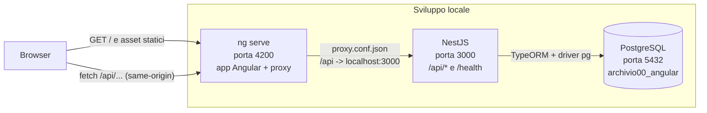
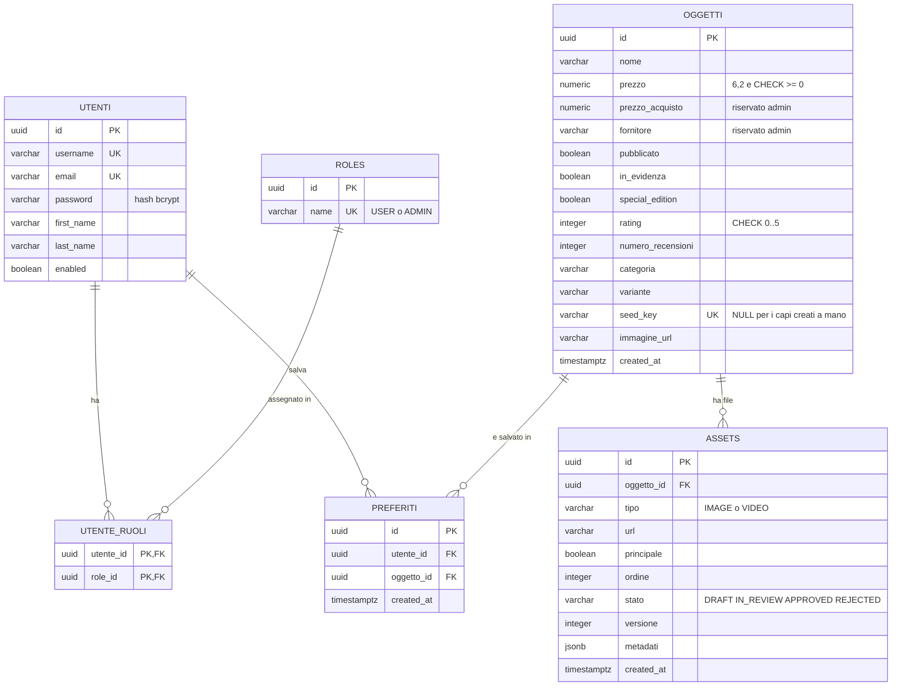
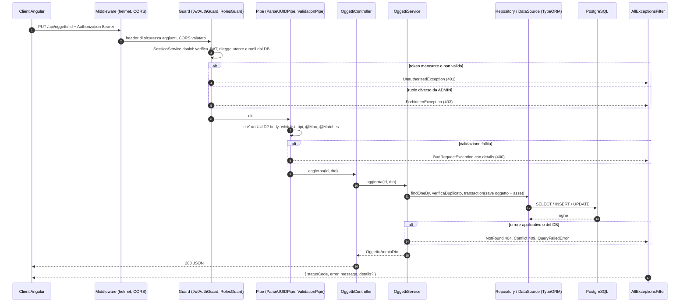
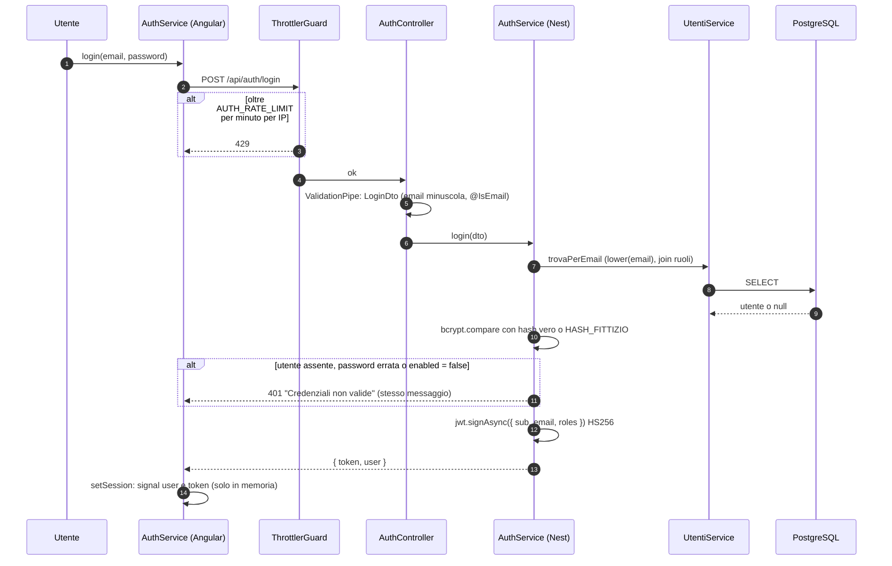
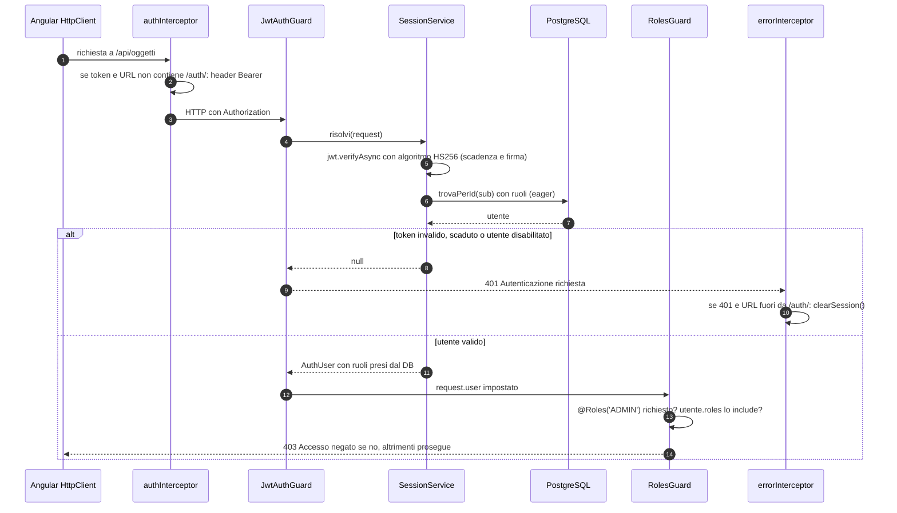
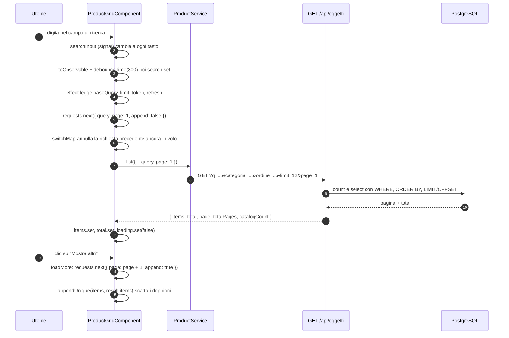
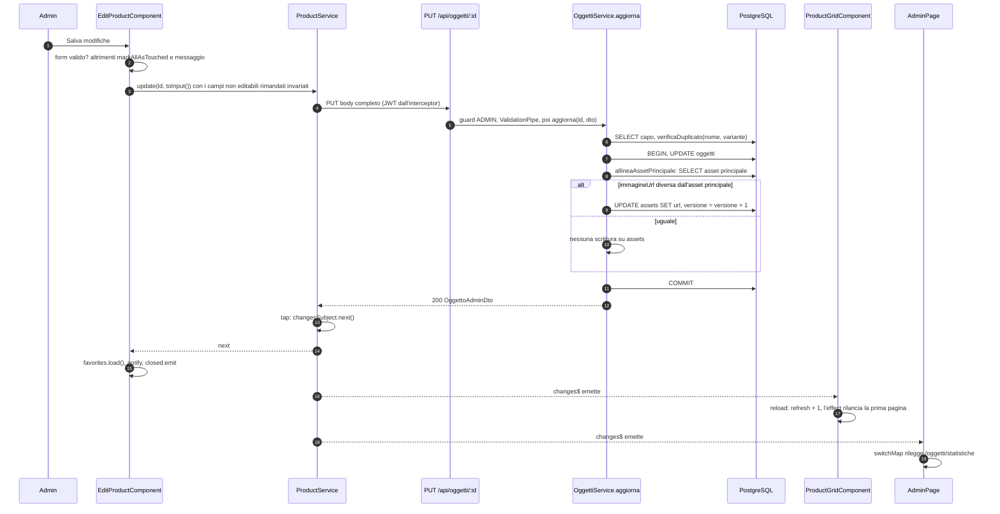
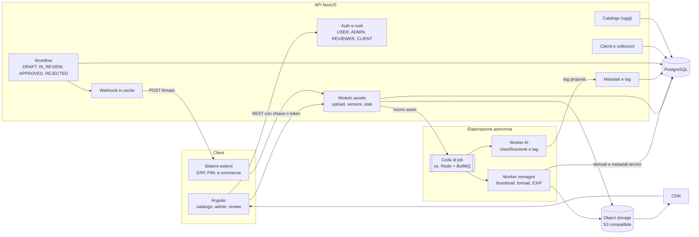

# ARCHIVIO 00 — Architettura

Guida tecnica per capire **come e' fatta** l'app e **perche'** e' fatta cosi'. Pensata per chi vuole orientarsi nel codice o prepararsi a discuterne le scelte, anche partendo da zero con Angular e NestJS.

Tutto cio' che e' citato (file, simboli, snippet, schema, piani di esecuzione) e' stato letto o eseguito sul codice reale. Dove qualcosa **non** e' stato verificato lo dico esplicitamente (sezione "Cosa non e' verificato" in fondo). Per il contratto API completo vedi [`API-CONTRACT.md`](./API-CONTRACT.md).

## Indice

1. [Struttura delle cartelle](#1-struttura-delle-cartelle)
2. [Architettura complessiva](#2-architettura-complessiva)
3. [Schema del database](#3-schema-del-database)
4. [Una richiesta HTTP in NestJS](#4-una-richiesta-http-in-nestjs)
5. [Autenticazione](#5-autenticazione)
6. [Caricamento del catalogo e modifica di un prodotto](#6-caricamento-del-catalogo-e-modifica-di-un-prodotto)
7. [Sicurezza applicata sul server](#7-sicurezza-applicata-sul-server)
8. [Performance e scalabilita'](#8-performance-e-scalabilita)
9. [Configurazione e ambienti](#9-configurazione-e-ambienti)
10. [Testing e comandi](#10-testing-e-comandi)
11. [Decisioni architetturali](#11-decisioni-architetturali)
12. [Roadmap: evoluzione verso un DAM](#12-roadmap-evoluzione-verso-un-dam)
13. [Cosa non e' verificato](#13-cosa-non-e-verificato)

---

## 1. Struttura delle cartelle

Albero reale (verificato con `ls`; omessi `node_modules`, `dist`, immagini e file generati).

```text
archivio00-angular/
├── avvia.command / ferma.command     avvio e arresto locale (porte 3000, 4200)
├── docker-compose.yml                Postgres 18 + backend opzionale (mai eseguito)
├── render.yaml                       blueprint di deploy su Render (non ancora verificato)
├── README.md
├── docs/                             ARCHITECTURE.md (questo file), DECISIONI.md,
│                                     API-CONTRACT.md, LEARNING-GUIDE.md
├── scripts/                          script Python per le immagini prodotto
├── BACKEND/                          NestJS 12 + TypeORM + PostgreSQL
│   ├── Dockerfile                    multi-stage (mai eseguito)
│   ├── nest-cli.json, tsconfig*.json, vitest.config*.ts
│   ├── test/                         api.e2e-spec.ts, rate-limit.e2e-spec.ts
│   └── src/
│       ├── main.ts                   bootstrap: crea l'app, configureApp, listen
│       ├── app.setup.ts              helmet, prefisso /api, ValidationPipe, filter, CORS
│       ├── app.module.ts             modulo radice: Config, TypeORM, moduli di dominio
│       ├── config/                   env.ts (validazione .env), load-env.ts
│       ├── common/                   all-exceptions.filter.ts, auth-user.ts,
│       │                             numeric.transformer.ts, security.ts
│       ├── auth/                     controller, service, guard JWT, RolesGuard,
│       │   └── dto/                  SessionService, @CurrentUser, DTO register/login
│       ├── utenti/                   entity Utente e Role, UtentiService
│       ├── oggetti/                  catalogo: controller, service, entity, mapper,
│       │   └── dto/                  categorie.ts, DTO di query e di scrittura
│       ├── preferiti/                entity Preferito, service, modulo
│       ├── assets/                   asset.entity.ts (base per il DAM)
│       ├── admin/                    admin.module.ts (gestione ruoli)
│       ├── health/                   health.module.ts (GET /health)
│       └── database/
│           ├── data-source.ts        UNICA definizione della connessione
│           ├── migrations/           1764000000000-InitialSchema.ts
│           ├── seed/                 catalogo.seed.ts, seed.service.ts
│           └── run-migrations.ts, run-seed.ts
└── FRONTEND/                         Angular 22
    ├── proxy.conf.json               /api -> http://localhost:3000
    ├── playwright.config.ts, e2e/    test end-to-end nel browser
    ├── public/                       immagini e video statici
    └── src/app/
        ├── app.config.ts             provideRouter + provideHttpClient(interceptor)
        ├── app.routes.ts             rotte con loadComponent (lazy)
        ├── core/                     guards/, interceptors/, models/, services/, util/
        ├── pages/                    home, catalog, legend, favorites, admin, editorial, not-found
        ├── shared/                   product-grid, product-card, edit-product, modal, ...
        ├── layout/                   navbar, footer, auth-modal, access-drawer
        └── data/                     contenuti editoriali statici (leggende, culture, descrizioni)
```

Regola mentale: **un modulo NestJS per dominio** (catalogo, auth, preferiti, utenti, asset) e, nel frontend, `core/` = servizi singleton e infrastruttura, `shared/` = componenti riusabili, `pages/` = componenti collegati a una rotta, `layout/` = struttura persistente dell'interfaccia.

---

## 2. Architettura complessiva



Punti da ricordare:

| Elemento | Dove e' nel codice |
|---|---|
| Frontend su 4200, chiama sempre URL **relativi** `/api/...` | `FRONTEND/src/app/core/services/*.ts` (es. `'/api/oggetti'`) |
| Il dev server inoltra `/api` a `:3000` | `FRONTEND/proxy.conf.json` + `proxyConfig` in `angular.json` (opzioni di `serve`) |
| API con prefisso `/api`, tranne `/health` | `app.setGlobalPrefix('api', { exclude: ['health'] })` in `app.setup.ts` |
| CORS abilitato per una sola origine, `FRONTEND_ORIGIN` | `app.enableCors({ origin: frontendOrigin, ... })` |
| Una sola definizione della connessione DB | `buildDataSourceOptions` in `database/data-source.ts` (usata da Nest, migration e seed) |

Perche' il proxy? Il browser vede **una sola origine** (4200): niente problemi di CORS in sviluppo e il frontend non conosce l'indirizzo del backend. Lo stesso principio vale in produzione: il sito statico e l'API stanno dietro un'unica origine (vedi `render.yaml`, regola di rewrite su `/api/*`).

Come sono combinati i pezzi, in breve:

| Livello | Scelta | Dove |
|---|---|---|
| Stato dell'interfaccia | `signal()` e `computed()` dentro componenti e servizi | `core/services/`, componenti in `shared/` |
| Stato condiviso | servizi `@Injectable({ providedIn: 'root' })` con signal | `core/services/` |
| Chiamate HTTP | `HttpClient` + RxJS + interceptor funzionali | `core/interceptors/` |
| Routing | `provideRouter` + `loadComponent` (lazy) | `app.routes.ts` |
| API REST | moduli NestJS con `@Controller`, `@Injectable`, DI nel costruttore | `BACKEND/src/*` |
| Accesso ai dati | `Repository<T>` e `QueryBuilder` di TypeORM | `*.service.ts` |
| Validazione | `ValidationPipe` globale + class-validator sui DTO | `app.setup.ts`, `dto/` |
| Errori | `AllExceptionsFilter` globale | `common/all-exceptions.filter.ts` |
| Accesso e ruoli | Guard (`JwtAuthGuard`, `RolesGuard`) | `auth/` |
| Configurazione | `.env` validato all'avvio da `validateEnv` | `config/env.ts` |
| Schema DB | migration versionate, `synchronize: false` | `database/migrations/` |

---

## 3. Schema del database

Fonte: `BACKEND/src/database/migrations/1764000000000-InitialSchema.ts`, confrontato con il database reale (`psql -h localhost -d archivio00_angular -c '\d oggetti'` e le altre tabelle; PostgreSQL 18). Il database contiene 7 tabelle: le 6 del dominio piu' la tabella `migrations` di TypeORM. Il seed crea un asset principale per ogni capo del catalogo.



### Vincoli e indici, con il motivo

| Tabella | Vincolo / indice | Perche' esiste |
|---|---|---|
| `utenti` | `uk_utente_email`, `uk_utente_username` (UNIQUE) | evitare duplicati esatti |
| `utenti` | `uk_utente_email_lower`, `uk_utente_username_lower` (UNIQUE su `lower(...)`) | `Mario@x.it` e `mario@x.it` sono lo stesso account: l'unicita' e' garantita **dal database**, non solo dal codice |
| `utente_ruoli` | PK `(utente_id, role_id)` + indice su `role_id` | tabella ponte N:N; la PK serve le ricerche per utente, l'indice quelle per ruolo (e le FK) |
| `oggetti` | `uk_oggetto_nome_variante` UNIQUE su `(lower(nome), lower(variante))` | stesso nome con varianti diverse e' lecito (camicie a righe), duplicati no |
| `oggetti` | `uk_oggetto_seed_key` UNIQUE | rende il seed idempotente: un capo del seed si riconosce dalla chiave anche se rinominato |
| `oggetti` | `idx_oggetti_catalogo` su `(pubblicato, in_evidenza DESC, created_at DESC)` | e' esattamente l'ordinamento "archivio" del catalogo pubblico |
| `oggetti` | `idx_oggetti_categoria`, `idx_oggetti_prezzo` | filtro per categoria e ordinamento per prezzo |
| `oggetti` | `idx_oggetti_special` **parziale** `WHERE special_edition` | indice piccolo: contiene solo le righe Special Edition |
| `oggetti` | `idx_oggetti_nome_trgm`, `idx_oggetti_variante_trgm` (GIN, `pg_trgm`) | rendono utilizzabile `ILIKE '%testo%'`, che un normale B-tree non puo' servire |
| `oggetti` | CHECK su prezzi, rating, recensioni | l'ultima difesa se un bug salta la validazione del DTO |
| `preferiti` | `uk_preferito_utente_oggetto` UNIQUE `(utente_id, oggetto_id)` | un capo si salva una sola volta; copre anche le ricerche per utente |
| `preferiti` | `idx_preferiti_oggetto` | serve la cancellazione a cascata quando si elimina un capo |
| `assets` | `uk_asset_principale` UNIQUE parziale su `(oggetto_id) WHERE principale` | **al massimo un** asset principale per capo, garantito dal DB |
| `assets` | `idx_assets_oggetto` `(oggetto_id, ordine)` | elenco ordinato dei file di un capo |
| `assets` | `idx_assets_metadati` GIN su `jsonb` | ricerche dentro i metadati (tag, esiti AI) quando serviranno |
| `assets` | CHECK su `tipo` e `stato` | valori ammessi: `IMAGE`/`VIDEO` e `DRAFT`/`IN_REVIEW`/`APPROVED`/`REJECTED` |

Chiavi esterne: tutte `ON DELETE CASCADE`. Eliminando un capo spariscono i suoi preferiti e i suoi asset; eliminando un utente spariscono preferiti e righe in `utente_ruoli`. Il service lo sfrutta: `elimina()` e' un solo `repo.delete({ id })`.

Dettagli che spesso si chiedono in colloquio:

- **UUID** come chiavi: `gen_random_uuid()` (con `uuidExtension: 'pgcrypto'` in `data-source.ts`). Niente id sequenziali indovinabili nelle URL.
- **`numeric(6,2)`** per i prezzi, mai `float`. Il driver `pg` restituisce `numeric` come **stringa** (`"750.00"`); `numeric.transformer.ts` la converte in `number`:

  ```ts
  from: (value?: string | null) => (value === null || value === undefined ? value : Number(value)),
  ```
- **Ruoli** in una tabella a parte (`roles` + `utente_ruoli`): un admin ha sia `USER` sia `ADMIN` (`UtentiService.impostaAdmin` mantiene `USER`).
- Le **migration** sono elencate a mano in `MIGRATIONS` di `data-source.ts`. Dimenticare di aggiungerne una all'array significa che non viene applicata.

---

## 4. Una richiesta HTTP in NestJS

Ordine reale: **middleware → guard → (interceptor) → pipe → controller → service → repository**; qualsiasi eccezione finisce nell'**exception filter**. Qui non ci sono interceptor di Nest personalizzati.

Esempio: `PUT /api/oggetti/:id` (un admin modifica un capo).



Dove si configura ciascun pezzo:

| Fase | Codice | Ruolo |
|---|---|---|
| Middleware | `app.use(helmet())`, `app.enableCors(...)` in `app.setup.ts` | header di sicurezza e CORS, prima di ogni logica |
| Guard | `@UseGuards(JwtAuthGuard, RolesGuard)` + `@Roles('ADMIN')` su `OggettiController` | decidono se la richiesta puo' proseguire (401/403) |
| Pipe | `ParseUUIDPipe` sul parametro; `ValidationPipe` globale in `app.setup.ts` | convertono e validano l'input prima che arrivi al controller |
| Controller | `OggettiController` (sottile: inoltra al service) | traduce HTTP in chiamate di dominio |
| Service | `OggettiService` (logica, transazioni) | regole di business |
| Repository | `Repository<Oggetto>`, `QueryBuilder`, `DataSource.transaction` | accesso al database |
| Filter | `AllExceptionsFilter` (`@Catch()`, globale) | un unico formato di errore per tutta l'API |

Il `ValidationPipe` globale, tratto da `app.setup.ts`:

```ts
new ValidationPipe({
  whitelist: true,
  forbidNonWhitelisted: true,
  transform: true,
  exceptionFactory: (errors) =>
    new BadRequestException({ message: 'Validation failed', details: raccogliDettagli(errors) }),
}),
```

`configureApp` e' usata sia da `main.ts` sia dai test e2e: i test esercitano **la stessa pipeline** della produzione.

Il filtro traduce anche gli errori di PostgreSQL (`AllExceptionsFilter`): codice `23505` (UNIQUE violata) → 409; classe `22…` (dati non validi per il tipo, es. byte NUL) → 400; tutto il resto → 500 generico, con lo stack solo nel log.

---

## 5. Autenticazione

Concetti: il JWT prova **chi sei**; i **ruoli** non si leggono dal token ma dal database a ogni richiesta (`SessionService`).

### 5.1 Registrazione e login



Frammenti reali (`BACKEND/src/auth/auth.service.ts`):

```ts
const HASH_FITTIZIO = bcrypt.hashSync('hash-fittizio', BCRYPT_ROUNDS);
...
const valida = await bcrypt.compare(dto.password, utente?.password ?? HASH_FITTIZIO);
if (!utente || !valida || !utente.enabled) throw new UnauthorizedException('Credenziali non valide');
```

Il confronto avviene **anche se l'email non esiste** e il messaggio e' identico: chi attacca non puo' distinguere "account inesistente" da "password errata", ne' dal tempo di risposta.

`register` salva `bcrypt.hash(dto.password, BCRYPT_ROUNDS)` (10 round, `common/security.ts`), assegna sempre il ruolo `USER` e restituisce anche un token. Email e username duplicati → 409 `"Username o email già registrati"`; la rete di sicurezza e' l'indice UNIQUE su `lower(...)`.

### 5.2 Richiesta autenticata e ruolo riletto



Cosa significa nel codice:

- `SessionService.risolvi` verifica **solo** firma e scadenza del token con `algorithms: ['HS256']` (cosi' un token `alg: none` e' rifiutato); poi carica l'utente dal DB:

  ```ts
  const payload = await this.jwt.verifyAsync<{ sub: string }>(header.slice(7), { algorithms: ['HS256'] });
  const utente = await this.utenti.trovaPerId(payload.sub);
  if (!utente?.enabled) return null;
  return { id: utente.id, email: utente.email, roles: utente.roles.map((r) => r.name) };
  ```
  Conseguenza: se un admin perde il ruolo, **la prossima richiesta** e' gia' negata anche con lo stesso token (c'e' un test e2e dedicato: "la revoca ha effetto IMMEDIATO sul token ancora valido"). Il prezzo e' una query in piu' per richiesta autenticata. I claim `email` e `roles` nel token servono solo al client.
- Due guard: `JwtAuthGuard` (401 se manca/e' invalido) e `OptionalJwtAuthGuard` (usato su `GET /oggetti`: un token assente o scaduto vale "visitatore", mai 401).
- `RolesGuard` legge i metadati di `@Roles('ADMIN')` con `Reflector` ed e' pensato per stare **dopo** `JwtAuthGuard`: se non c'e' `request.user` risponde 403.
- Lato Angular: `authInterceptor` aggiunge `Authorization: Bearer ...` a tutto tranne `/auth/`; `errorInterceptor` su un 401 fuori da `/auth/` chiama `auth.clearSession()`. L'ordine e' dichiarato in `app.config.ts`: `withInterceptors([authInterceptor, errorInterceptor])`.
- La sessione sta **solo in memoria** (signal `token` e `user` in `AuthService`): un refresh della pagina riparte da visitatore. E' una scelta dichiarata nel commento della classe.
- `adminGuard` (Angular) e' solo comodita' di navigazione, e lo dice il commento: `(La vera sicurezza resta nel backend.)`.

Strumenti usati:

| Cosa | Strumento | Dove |
|---|---|---|
| Hash password | `bcryptjs` | `auth.service.ts`, `common/security.ts` |
| Verifica del token | `JwtAuthGuard` + `SessionService` | `auth/` |
| Utente corrente nei controller | `@CurrentUser()` | `current-user.decorator.ts` |
| Ruoli sugli endpoint | `@Roles(...)` + `RolesGuard` | `roles.guard.ts` |
| Limite di tentativi | `@nestjs/throttler` (`ThrottlerGuard` sul solo `AuthController`) | `auth.module.ts` |

---

## 6. Caricamento del catalogo e modifica di un prodotto

### 6.1 Caricamento con ricerca, filtri e paginazione

Il componente e' `FRONTEND/src/app/shared/product-grid.component.ts`. Tutto lo stato e' in `signal`; **un unico stream** `requests` con `switchMap` garantisce che arrivi sempre e solo la risposta dell'ultima richiesta.



Pezzi chiave estratti dal componente:

```ts
// switchMap: una nuova richiesta annulla quella in corso (HTTP abortita, risposta mai applicata).
this.requests.pipe(switchMap((req) => this.fetch(req)), takeUntilDestroyed(destroyRef)).subscribe();

// Debounce della ricerca: il campo e' reattivo, il server viene interrogato dopo 300 ms di pausa.
toObservable(this.searchInput).pipe(debounceTime(300), takeUntilDestroyed(destroyRef))
  .subscribe((value) => this.search.set(value.trim()));
```

Il `catchError` dentro `fetch` restituisce `EMPTY` dopo aver messo l'errore nello stato: se l'errore salisse fino allo stream esterno, lo chiuderebbe e la griglia non caricherebbe piu' nulla.

Come leggere i pezzi reattivi: `debounceTime` aspetta una pausa nella digitazione prima di agire; `switchMap` abbandona la richiesta precedente quando ne parte una nuova (il browser abortisce la HTTP); `effect()` si riesegue quando cambiano i signal che legge, tracciati automaticamente; `computed()` deriva un valore da altri signal e si ricalcola solo quando serve.

Lato server (`OggettiService.lista`): i filtri sono `andWhere` condizionali, la ricerca usa `ILIKE` con i caratteri speciali neutralizzati da `escapeLike`, l'ordinamento e' chiuso da `o.id` (tie-break) e la paginazione usa `skip/take`:

```ts
if (!admin) qb.andWhere('o.pubblicato = true');
else if (query.soloBozze) qb.andWhere('o.pubblicato = false');
...
qb.addOrderBy('o.id', 'ASC');
qb.skip((page - 1) * limit).take(limit);
const [righe, total] = await qb.getManyAndCount();
const catalogCount = await this.repo.countBy(admin ? {} : { pubblicato: true });
```

Chi e' admin si decide **sul server** (`req.user?.roles.includes('ADMIN')`); `soloBozze=true` e' ignorato per gli altri.

### 6.2 Modifica di un prodotto (admin)

`EditProductComponent` → `ProductService.update` → `PUT /api/oggetti/:id` → transazione che salva il capo **e** allinea l'asset principale → il componente ricarica la lista tramite `changes$`.



Dettagli verificati nel codice:

- `PUT` e' **parziale per i campi opzionali**: `oggetto.rating = input.rating ?? oggetto.rating;` (omettere un campo non lo azzera). `nome`, `prezzo`, `prezzoAcquisto`, `fornitore`, `pubblicato`, `inEvidenza` sono obbligatori.
- `verificaDuplicato` gira **prima** della transazione; se due richieste concorrenti superano il controllo, l'indice UNIQUE `uk_oggetto_nome_variante` fa fallire la seconda con `23505` e il filtro la trasforma in 409.
- `allineaAssetPrincipale` tiene `assets.url` uguale a `oggetti.immagine_url` e incrementa `versione` solo quando l'immagine cambia (test e2e: "asset principale: creato con il capo, versione+1 solo quando cambia immagineUrl").
- `changes$` e' un `Subject<void>` in `ProductService`; `create`, `update` e `remove` fanno `tap(() => this.changesSubject.next())` **solo in caso di successo**. Chiunque sia interessato (griglia, pagina admin) si sottoscrive: e' un piccolo bus di eventi senza store globale.

---

## 7. Sicurezza applicata sul server

Principio: **il frontend non e' un confine di sicurezza**. Nasconde bottoni e rotte per comodita'; ogni regola vera sta nel backend.

| Misura | Dove | Effetto |
|---|---|---|
| **helmet** | `app.use(helmet())` in `app.setup.ts` | header di sicurezza (nosniff, no-referrer, CSP...), nessun `X-Powered-By`. Test: "header di sicurezza presenti e nessun X-Powered-By" |
| **Throttler** | `ThrottlerModule.forRootAsync` in `auth.module.ts` (60 s, limite `AUTH_RATE_LIMIT`, default 30) + `@UseGuards(ThrottlerGuard)` su `AuthController` | 429 su troppi tentativi di login/registrazione per IP. Applicato **solo** a `/auth/*`, non a tutta l'API |
| **TRUST_PROXY** | `express.set('trust proxy', n)` se `TRUST_PROXY > 0` | dietro un reverse proxy (es. Render, valore 1) il limite per IP usa l'IP vero e non quello del proxy |
| **Whitelist DTO** | `whitelist: true, forbidNonWhitelisted: true` | un campo non previsto nel body → 400, non viene ignorato in silenzio (contro il *mass assignment*) |
| **Tipi e limiti** | decoratori in `oggetto-request.dto.ts`, `auth.dto.ts`, `lista-oggetti.query.ts` | es. `@Max(9999.99)`, `@MaxLength(180)`, `limit` ≤ 60, `categoria` solo tra le 7 ammesse |
| **Validazione `immagineUrl`** | `@Matches(/^(\/(?!\/)\S*|https?:\/\/\S+)?$/)` | solo percorso locale `/...` o `http(s)://`; bloccati `javascript:`, `data:`, e `//host` (protocol-relative) |
| **DTO espliciti** | `oggetti.mapper.ts`: `toPublic` elenca i campi uno per uno | una nuova colonna riservata non esce per errore; `prezzoAcquisto` e `fornitore` solo in `toAdmin` |
| **Ruolo riletto dal DB** | `SessionService` | revoca ADMIN immediata |
| **Password** | bcrypt 10 round; mai restituita (`comeResponse` non la include) | test: "nessuna password nella risposta" |
| **SQL injection** | query parametrizzate (`:q`, `:categoria`, `:...chiavi`) + `escapeLike` | `%` e `_` digitati dall'utente sono caratteri letterali |
| **Isolamento dei dati** | l'utente dei preferiti viene dal token, mai dal path | un utente non puo' leggere/rimuovere preferiti altrui (test "isolamento") |
| **Errori controllati** | `AllExceptionsFilter` | i dettagli interni (stack) non escono mai al client; il 500 e' generico |
| **JWT_SECRET** | `validateEnv` | minimo 32 caratteri; in produzione il valore di esempio e' rifiutato |
| **CORS** | `enableCors` con una sola origine e metodi/header elencati | niente `*` |
| **Fail-fast** | `validateEnv` | un `.env` sbagliato blocca l'avvio |

Esempio di body rifiutato dal filtro (formato reale del contratto):

```json
{ "statusCode": 400, "error": "Bad Request", "message": "Validation failed", "details": { "prezzo": "prezzo must not be less than 0" } }
```

Cosa **non** c'e' (e ne puoi parlare onestamente): refresh token e rotazione, logout lato server (il JWT e' stateless: `POST /auth/logout` e' un no-op), blocco dell'account dopo N tentativi (c'e' solo il limite per IP), audit log delle azioni admin, upload di file (quindi nessuna scansione antivirus o controllo del tipo MIME: oggi `immagineUrl` e' solo un testo).

---

## 8. Performance e scalabilita'

### 8.1 Cosa e' stato fatto

| Tecnica | Dove | Perche' |
|---|---|---|
| **Paginazione server-side** | `GET /oggetti` (`page`, `limit` ≤ 60, `totalPages`) | il client riceve una pagina per volta, non l'intero catalogo |
| **Filtri e ricerca nel DB** | `OggettiService.lista` | il database filtra con gli indici, il browser non scarica tutto |
| **Indici trigram** | `idx_oggetti_nome_trgm`, `idx_oggetti_variante_trgm` | `ILIKE '%testo%'` senza scansione completa (a regime) |
| **Indice a misura dell'ordinamento** | `idx_oggetti_catalogo` | l'ordinamento "archivio" legge righe gia' ordinate |
| **Tie-break su `id`** | `addOrderBy('o.id', 'ASC')` | pagine stabili: niente capi ripetuti o saltati |
| **N+1 evitato** | `PreferitiService.lista`: `innerJoinAndSelect('p.oggetto', 'o')` | un solo SELECT con JOIN invece di una query per preferito |
| **Ruoli eager** | `@ManyToMany(() => Role, { eager: true })` in `utente.entity.ts` | utente e ruoli in una query |
| **Annullamento richieste** | `switchMap` in griglia e in `FavoriteService` | una risposta vecchia non sovrascrive quella nuova; il browser abortisce la HTTP |
| **Debounce 300 ms** | `ProductGridComponent` | meno richieste mentre si digita |
| **Lazy loading** | `loadComponent: () => import(...)` in `app.routes.ts` | ogni pagina e' un chunk scaricato solo quando serve |
| **`ChangeDetectionStrategy.OnPush` + signal** | tutti i componenti letti | il rendering riparte solo quando cambia un signal |
| **Transazione corta** | `dataSource.transaction` in `crea`/`aggiorna` | capo e asset sono atomici |

### 8.2 Query SQL ed EXPLAIN ANALYZE

Eseguiti in sola lettura sul database di sviluppo (`BEGIN READ ONLY ... ROLLBACK`, PostgreSQL 18). Le query sono scritte a mano **equivalenti** a quelle generate da TypeORM (non ho catturato il SQL emesso dall'app: i nomi delle colonne sono quelli reali del database). Riporto la forma dei piani, non i tempi: su un catalogo di poche decine di righe i tempi sono rumore.

**Importante: con cosi' poche righe il planner sceglie quasi sempre la scansione sequenziale**: leggere una pagina da 8 KB costa meno che usare un indice. E' corretto, non un difetto. Per mostrare che gli indici *sono utilizzabili* ho disattivato nella sola transazione `enable_seqscan` (e, per il trigram, anche `enable_indexscan`). Quei piani dimostrano la possibilita', **non** misurano il vantaggio: per quello servono migliaia di righe, che non ho generato (e non avrei potuto scrivere nel DB).

**Q1 — pagina del catalogo pubblico, ordine "archivio"**

```sql
SELECT * FROM oggetti o
WHERE o.pubblicato = true
ORDER BY o.in_evidenza DESC, o.created_at DESC, o.id ASC
LIMIT 12 OFFSET 0;
```

Piano naturale: `Seq Scan on oggetti` + `Sort Method: top-N heapsort`. Con `enable_seqscan = off`:

```text
Limit
  ->  Incremental Sort
        Sort Key: in_evidenza DESC, created_at DESC, id
        Presorted Key: in_evidenza, created_at
        ->  Index Scan using idx_oggetti_catalogo on oggetti o
              Index Cond: (pubblicato = true)
```

Lettura: l'indice `idx_oggetti_catalogo` fornisce le righe gia' in ordine `(in_evidenza, created_at)`; resta da ordinare solo il tie-break `id` (*Incremental Sort*), e il `LIMIT` ferma la lettura dopo poche righe invece di ordinarle tutte. Con milioni di righe e' questa la differenza che conta.

**Q2 — ricerca parziale `ILIKE`**

```sql
SELECT * FROM oggetti o
WHERE o.pubblicato = true AND (o.nome ILIKE '%denim%' OR o.variante ILIKE '%denim%');
```

Piano naturale: `Seq Scan` con filtro. Con solo `enable_seqscan = off` il planner usa comunque `idx_oggetti_catalogo` (per `pubblicato`) e filtra il resto: **gli indici trigram non vengono scelti**. Disattivando anche `enable_indexscan` e togliendo `pubblicato` dalla condizione:

```text
Bitmap Heap Scan on oggetti o
  Recheck Cond: (nome ~~* '%denim%' OR variante ~~* '%denim%')
  ->  BitmapOr
        ->  Bitmap Index Scan on idx_oggetti_nome_trgm
        ->  Bitmap Index Scan on idx_oggetti_variante_trgm
```

Lettura: i due indici GIN trigram sono combinabili con `BitmapOr` e `ILIKE '%...%'` diventa servibile da indice. Il bitmap restituisce piu' candidati dei risultati veri: l'indice trigram e' **lossy** e il `Recheck Cond` rivaluta la condizione sulle righe. Onesta' sui limiti: non ho dimostrato che il planner scelga il trigram con la query completa (con `pubblicato` e `ORDER BY`) a dati reali; con poche righe e' impossibile da osservare.

**Q3 — filtro per categoria**

```sql
SELECT * FROM oggetti WHERE categoria = 'Denim';
```

Con seqscan disattivato: `Index Scan using idx_oggetti_categoria`, `Index Cond: (categoria = 'Denim')`.

**Q4 — preferiti di un utente (niente N+1)**

```sql
SELECT p.*, o.* FROM preferiti p
INNER JOIN oggetti o ON o.id = p.oggetto_id
WHERE p.utente_id = $1 AND o.pubblicato = true
ORDER BY p.created_at DESC, p.id ASC;
```

Piano reale: `Hash Join` tra `Bitmap Index Scan on uk_preferito_utente_oggetto` (il vincolo UNIQUE serve la ricerca per utente) e `Seq Scan on oggetti`; un'unica esecuzione. Il piano mostra la forma della query, non un carico reale.

**Q5 — asset principale di un capo**

```sql
SELECT * FROM assets WHERE oggetto_id = $1 AND principale = true;
```

`Index Scan using uk_asset_principale` (l'indice unico **parziale**).

**Q6 — conteggio del catalogo (`catalogCount`)**

```sql
SELECT count(*) FROM oggetti WHERE pubblicato = true;
```

`Seq Scan` + `Aggregate`. A grandi volumi un `count(*)` costa (PostgreSQL deve controllare la visibilita' delle righe); tienilo in mente nella sezione sui limiti.

### 8.3 Limiti noti

- **`OFFSET` rallenta con le pagine profonde**: `OFFSET n` fa leggere e scartare `n` righe. Con un catalogo grande si passa a **keyset pagination** (`WHERE (in_evidenza, created_at, id) < (...)`). Il tie-break su `id` e' gia' il primo passo.
- **Tre query per una lista**: `getManyAndCount` ne esegue due (dati e totale) piu' `countBy` per `catalogCount`. Con pochi capi va bene; si puo' mettere in cache `catalogCount`.
- **`created_at` come tie-break nel prezzo**: l'ordine per prezzo e' `prezzo ASC, created_at DESC, id ASC`; solo `prezzo` ha un indice dedicato, non la tripla.
- **Nessuna cache** (HTTP o applicativa) e nessun CDN per le immagini: oggi sono file statici in `FRONTEND/public/assets`.
- **Niente test di carico**: non ho misurato throughput, latenza sotto concorrenza ne' dimensionato il pool di connessioni (default del driver `pg`).

---

## 9. Configurazione e ambienti

Le variabili sono lette e validate all'avvio da `BACKEND/src/config/env.ts` (`validateEnv`, passata a `ConfigModule.forRoot({ isGlobal: true, validate: validateEnv })`). Un valore sbagliato **blocca subito** l'app con un messaggio chiaro, invece di far emergere l'errore a meta' di una richiesta.

| Variabile | Default | Nota |
|---|---|---|
| `NODE_ENV` | `development` | solo `development` / `production` / `test` |
| `PORT` | `3000` | |
| `FRONTEND_ORIGIN` | `http://localhost:4200` | unica origine CORS ammessa |
| `DATABASE_URL` | – | se presente prevale su `DB_*` (pensata per Render) |
| `DB_HOST` `DB_PORT` `DB_USER` `DB_PASSWORD` `DB_NAME` | `localhost`, `5432`, utente di sistema, vuota, `archivio00_angular` | |
| `DB_SSL` | `false` | con `true`: `ssl: { rejectUnauthorized: false }` (accetta qualsiasi certificato: comodo per un DB gestito, ma meno rigoroso) |
| `JWT_SECRET` | obbligatoria | ≥ 32 caratteri, in produzione non puo' contenere `change-me` |
| `JWT_EXPIRES_IN` | `24h` | |
| `SEED_DEMO_USERS` | `true`, tranne in `production` | crea gli account dimostrativi |
| `AUTH_RATE_LIMIT` | `30` | richieste/minuto per IP su login e registrazione |
| `TRUST_PROXY` | `0` | numero di proxy fidati davanti all'API |

Ambienti:

| Ambiente | Come | Note |
|---|---|---|
| Sviluppo | `avvia.command`: crea DB e `.env` se mancano, migration + seed, avvia le due app | usato in locale |
| Test e2e backend | DB `archivio00_angular_test`, azzerato a ogni run | il test **rifiuta di partire** se `DB_NAME` non finisce con `_test` o se esiste `DATABASE_URL` |
| Produzione | `npm run build && npm run start:prod` (`node dist/main.js`) | `NODE_ENV=production`; migration con `node dist/database/run-migrations.js` |
| Docker | `BACKEND/Dockerfile` (multi-stage, utente `node`) e `docker-compose.yml` | **mai eseguiti** |
| Render | `render.yaml` (database, API, sito statico con rewrite su `/api/*`) | **non ancora verificato** |

`synchronize: false` e' fisso in `buildDataSourceOptions`: lo schema cambia **solo** con migration. Il motivo: con `synchronize: true` TypeORM allinea il database alle entity all'avvio e, in produzione, puo' modificare o perdere dati. Il processo corretto e' scrivere una classe in `database/migrations/`, aggiungerla a `MIGRATIONS` e lanciare `npm run db:migrate`.

Il seed (`seed.service.ts`) e' **idempotente**: i capi si riconoscono da `seed_key`, non si sovrascrivono le modifiche degli admin e l'asset principale mancante viene ricreato (test "seed" in `api.e2e-spec.ts`).

Frontend in produzione: il codice chiama URL relativi `/api/...` e nel progetto non esiste un file di environment con l'URL dell'API. Quindi **in produzione serve un punto unico davanti a frontend e backend** (un reverse proxy o, su Render, la regola di rewrite del sito statico). Il proxy di `proxy.conf.json` vale solo per `ng serve`. Questo setup non e' stato provato.

---

## 10. Testing e comandi

| Livello | Dove | Comando | Note |
|---|---|---|---|
| Unitari backend | `BACKEND/src/**/*.spec.ts` (`auth.service.spec.ts`, `env.spec.ts`, `categorie.spec.ts`) | `cd BACKEND && npm test` | Vitest, nessun database; i servizi si testano con mock |
| E2E backend | `BACKEND/test/api.e2e-spec.ts`, `rate-limit.e2e-spec.ts` | `cd BACKEND && npm run test:e2e` | app Nest vera + supertest + PostgreSQL di test; `rate-limit` e' separato perche' imposta `AUTH_RATE_LIMIT=5` prima dell'import di `AppModule` |
| Unitari frontend | `FRONTEND/src/**/*.spec.ts` | `cd FRONTEND && npm test` | `ng test`: servizi, guard, interceptor, utility e componenti |
| E2E frontend | `FRONTEND/e2e/*.spec.ts` (`archive`, `catalog`, `catalog-server`) | `cd FRONTEND && npm run e2e` | Playwright contro `ng serve` su 4200 e backend su 3000 |
| Lint | `npm run lint` in entrambi | oxlint (backend con regole type-aware) | |

Cosa coprono gli e2e del backend (dai titoli dei test): forma del DTO pubblico, bozze invisibili ai visitatori, paginazione e limiti, filtri e ordinamenti, `%` e `_` letterali, CRUD admin con 403/401, asset principale e versione, cascade, preferiti e isolamento, ruoli con revoca immediata, token `alg: none` o scaduti, seed idempotente, header di sicurezza, byte NUL.

Comandi di sviluppo:

```sh
./avvia.command --no-browser                  # tutto in locale
cd BACKEND && npm run db:setup                # migration + seed
cd BACKEND && npm run start:dev               # API con watch
cd FRONTEND && npx ng serve --port 4200 --proxy-config proxy.conf.json
```

Questo documento non riporta conteggi di test passati: cambiano a ogni modifica, il riferimento e' l'esito dell'ultima esecuzione dei comandi qui sopra.

---

## 11. Decisioni architetturali

Ogni scelta con il motivo e il compromesso accettato.

| Decisione | Perche' | Compromesso |
|---|---|---|
| **Angular con componenti standalone, signal e `OnPush`** | I signal rendono esplicito cosa fa ridisegnare la UI; con `OnPush` il rendering riparte solo quando cambia un signal. Niente `NgModule` da mantenere. | Si usa RxJS solo dove serve davvero (debounce, annullamento, bus di eventi), quindi bisogna conoscere entrambi i modelli. |
| **Rotte lazy con `loadComponent`** | Ogni pagina e' un chunk scaricato solo quando serve: la home pesa meno. | Un piccolo ritardo alla prima apertura di una pagina. |
| **Un solo stream di richieste con `switchMap` nella griglia** | Una risposta vecchia non puo' mai sovrascrivere una nuova (ricerca digitata in fretta, cambio filtro). | Lo stream va protetto con `catchError` interno, altrimenti un errore lo chiude. |
| **Sessione solo in memoria, nessun `localStorage`** | Un token in `localStorage` e' leggibile da qualsiasi script iniettato (XSS). In memoria il rischio si riduce. | Un refresh della pagina riparte da visitatore. Con un refresh token in cookie `HttpOnly` si risolverebbe (non implementato). |
| **NestJS a moduli per dominio** | Ogni dominio ha controller, service, entity e DTO nella stessa cartella: i confini sono chiari e i moduli si possono estendere (vedi roadmap DAM) senza toccare gli altri. | Piu' file per feature rispetto a una struttura piatta. |
| **Controller sottili, logica nei service** | Il controller traduce HTTP, il service decide. La logica si testa senza HTTP e si riusa. | Un livello in piu' da attraversare leggendo il codice. |
| **PostgreSQL con TypeORM e migration (`synchronize: false`)** | Vincoli, indici parziali, trigram e `jsonb` sono funzioni del database, non dell'ORM. Le migration rendono lo schema ripetibile e revisionabile. | Le migration vanno scritte a mano e registrate in `MIGRATIONS`. |
| **Regole di integrita' nel database, non solo nel codice** | UNIQUE su `lower(...)`, CHECK su prezzi e rating, asset principale unico: restano vere anche se un bug salta la validazione o due richieste arrivano insieme. | Le regole sono duplicate (DTO e DB): il DTO da' messaggi chiari, il DB e' l'ultima difesa. |
| **UUID come chiavi, `numeric(6,2)` per i prezzi** | Id non indovinabili nelle URL; nessun errore di arrotondamento sui soldi. | Un transformer converte `numeric` (stringa per il driver `pg`) in `number`. |
| **JWT stateless con ruoli riletti dal DB a ogni richiesta** | La revoca di un ruolo ha effetto subito, anche su un token ancora valido. | Una query in piu' per richiesta autenticata. |
| **Messaggio di login unico e confronto bcrypt anche per email inesistente** | Chi attacca non distingue "account inesistente" da "password errata", ne' dal tempo di risposta. | Un hash bcrypt calcolato anche quando non servirebbe. |
| **DTO in uscita espliciti (`toPublic`, `toAdmin`)** | Un campo riservato (`prezzoAcquisto`, `fornitore`) non esce per distrazione quando si aggiunge una colonna. | Il mapper va aggiornato a mano per ogni nuovo campo pubblico. |
| **Whitelist rigorosa sui DTO (`forbidNonWhitelisted`)** | Un campo non previsto e' un errore 400, non un valore ignorato in silenzio: protegge dal mass assignment. | I client devono inviare solo i campi del contratto. |
| **Un unico formato di errore (`AllExceptionsFilter`)** | Il frontend gestisce un solo shape; lo stack non esce mai; gli errori del DB diventano 409/400 sensati. | Il filtro va tenuto allineato ai codici PostgreSQL usati. |
| **Validazione del `.env` all'avvio (fail-fast)** | Una configurazione sbagliata (segreto debole, valore di esempio in produzione) blocca l'avvio invece di diventare una falla. | Serve un `.env` completo anche in sviluppo (lo crea `avvia.command`). |
| **Rate limit solo su `/auth/*`** | Sono gli endpoint piu' esposti al brute force; il resto dell'API non ha bisogno dello stesso limite. | Il resto dell'API non e' limitato; per un uso pubblico intenso andrebbe esteso. |
| **Paginazione e filtri nel server** | Il client scarica una pagina, non il catalogo; il DB usa gli indici. | `OFFSET` rallenta sulle pagine profonde: la keyset pagination e' il passo successivo. |
| **Tabella `assets` separata dai capi** | Separa i dati del prodotto dai contenuti multimediali: e' il punto di partenza naturale per galleria, video e workflow di approvazione. | Per ora c'e' un solo asset per capo, tenuto allineato a `immagine_url`. |
| **Stessa `configureApp` per app e test e2e** | I test esercitano la pipeline reale (helmet, pipe, filtro): niente differenze tra test e produzione. | I test e2e richiedono un PostgreSQL dedicato (`_test`). |
| **Seed idempotente con `seed_key`** | Si puo' rilanciare a ogni avvio (anche in deploy) senza duplicare ne' sovrascrivere le modifiche degli admin. | Ogni capo del seed deve avere una chiave stabile. |
| **Contenuti editoriali statici nel frontend (`data/`)** | Leggende, culture e descrizioni sono testi curati, non dati da gestire: restano versionati con il codice e senza chiamate in piu'. | Modificarli richiede un nuovo build. |

---

## 12. Roadmap: evoluzione verso un DAM

> **Questa sezione e' un piano di lavoro, non codice esistente.** Nulla di quanto segue e' stato implementato; descrive dove l'architettura attuale e' gia' predisposta e dove no.

### 12.1 Punto di partenza

La tabella `assets` esiste (migration iniziale) e contiene un asset principale per ogni capo, tenuto allineato a `oggetti.immagine_url` da `allineaAssetPrincipale`. Ha gia' i campi del DAM:

| Campo di `assets` | Uso previsto |
|---|---|
| `tipo` (`IMAGE`/`VIDEO`) | piu' formati |
| `principale` + indice unico parziale | un'immagine "di copertina" per capo |
| `ordine` | galleria ordinata |
| `stato` (`DRAFT`, `IN_REVIEW`, `APPROVED`, `REJECTED`) | workflow di approvazione (il default oggi e' `APPROVED`) |
| `versione` | versioning (oggi sale di 1 quando cambia l'URL del principale) |
| `metadati` (`jsonb` + GIN) | dimensioni, tag, didascalie, esito AI (come dice il commento dell'entity) |

Cosa **manca**: un endpoint per gli asset (non c'e' un `AssetsController`), l'upload di file, uno storage, la storia delle versioni (oggi `versione` e' un contatore: la vecchia URL viene sovrascritta e non conservata), tag normalizzati, clienti/collezioni, qualsiasi elaborazione asincrona.

### 12.2 Architettura target



Scelte di principio (motivate, non obbligatorie): il **file non passa dal database** (si salva solo l'URL/chiave nello storage e i metadati in `assets`); i job pesanti stanno **fuori dalla richiesta HTTP** (coda + worker) cosi' un upload risponde subito; il client scarica da CDN, non dall'API.

### 12.3 Dai punti del piano alle modifiche

| Tema | Modello dati / API (proposta) | Dove si appoggia l'esistente |
|---|---|---|
| **Asset multipli e versioning** | `POST /oggetti/:id/assets`, `GET /assets/:id`; nuova tabella `asset_versioni (id, asset_id, versione, storage_key, checksum, created_at)` e `assets` che punta alla versione corrente | `assets.versione`, `ordine`, indice `idx_assets_oggetto` |
| **Upload e storage** | upload diretto a object storage con URL pre-firmato (il file non attraversa NestJS) oppure `multipart` limitato; salvare `storage_key`, `mime`, `size`, `checksum` | `assets.url` (oggi percorso/URL), `@Matches` su `immagineUrl` come esempio di validazione |
| **Metadati e tag** | `metadati jsonb` per i dati variabili; tabella `tag` + `asset_tag` per quelli ricercabili e controllati | indice GIN su `metadati` |
| **Workflow di stato** | transizioni ammesse `DRAFT→IN_REVIEW→APPROVED/REJECTED`, ruolo `REVIEWER`, tabella `asset_eventi (asset_id, da, a, utente_id, nota, created_at)` come audit | campo `stato` e CHECK gia' presenti; `RolesGuard` per i nuovi ruoli; ruoli gia' in `roles` |
| **Clienti e collezioni** | `clienti`, `collezioni`, `collezione_asset` (N:N); accesso per cliente (un `CLIENT` vede solo le sue collezioni) | stesso schema N:N di `utente_ruoli`; `OptionalJwtAuthGuard` come modello per rotte miste |
| **Classificazione AI** | un worker legge l'immagine, scrive `metadati.ai = { tag, confidenza }` come **proposta**; un umano approva | `metadati` + stato `IN_REVIEW` |
| **Integrazioni REST e webhook** | chiavi API per sistemi esterni; webhook `asset.approved`, `asset.rejected` con firma HMAC e ritentativi | contratto REST gia' documentato in `API-CONTRACT.md`; formato errori uniforme |
| **Code per elaborazione immagini** | job `genera-derivati`, `estrai-metadati`; tabella o stato `elaborazione` per l'esito | nessuna coda esiste oggi |

### 12.4 Passi incrementali

Ogni passo e' retrocompatibile: il catalogo continua a funzionare perche' `oggetti.immagine_url` resta la fonte per il frontend finche' non si decide altrimenti.

1. **Rendere `assets` leggibile.** Aggiungere `GET /oggetti/:id/assets` (solo lettura, DTO esplicito come `toPublic`). Nessuna modifica allo schema, il frontend non cambia.
2. **Migration additive.** Nuove colonne **nullable o con default** su `assets` (`storage_key`, `mime`, `size`, `checksum`) e tabella `asset_versioni`: il seed e `allineaAssetPrincipale` continuano a funzionare. Una migration per volta, in `MIGRATIONS`.
3. **Upload di un secondo asset** (galleria) con `principale = false`. Il principale e il campo `immagine_url` restano com'erano. Validare tipo e dimensione lato server.
4. **Versioning vero.** Ad ogni sostituzione scrivere una riga in `asset_versioni` invece di sovrascrivere; mantenere il contatore `versione`. Aggiornare `allineaAssetPrincipale` in un solo punto.
5. **Workflow.** Abilitare le transizioni di `stato` con controllo del ruolo; il catalogo pubblico mostra solo asset `APPROVED` (oggi il default e' gia' `APPROVED`, quindi nulla cambia per i dati esistenti). Aggiungere `asset_eventi`.
6. **Storage esterno + CDN.** Spostare i file nello object storage; `assets.url` punta alla CDN. Trasferimento dei file esistenti con uno script ripetibile.
7. **Coda e worker** per thumbnail e metadati tecnici; poi il worker AI che propone tag.
8. **Tag, clienti, collezioni** come nuovi moduli NestJS (ognuno con la propria migration), seguendo il pattern di `oggetti/` (entity, DTO, mapper, service, controller).
9. **Webhook e chiavi API** per le integrazioni, con rate limit dedicato (il `ThrottlerModule` attuale e' limitato ad `AuthModule`).

Rischi da tenere presenti: l'estensione dei **ruoli** (oggi solo `USER`/`ADMIN`, controllati con stringhe in `@Roles`); la **consistenza** tra storage e database (file caricato ma riga non salvata o viceversa: serve un job di pulizia); la **dimensione** delle risposte quando un capo avra' molti asset (paginare anche quelle); e che la paginazione con `OFFSET` andra' rivista (sezione 8.3).

---

## 13. Cosa non e' verificato

- **Docker**: non e' installato sul Mac di sviluppo. `BACKEND/Dockerfile` e `docker-compose.yml` non sono mai stati costruiti ne' eseguiti.
- **Deploy su Render** (`render.yaml`): non provato. I campi `DATABASE_URL`, `DB_SSL` e `TRUST_PROXY` sono previsti per quel caso ma non collaudati.
- **Frontend in produzione** (rewrite di `/api` verso l'API): configurato in `render.yaml` ma non provato.
- **Performance a regime**: gli EXPLAIN sono su un catalogo di poche decine di righe; gli indici sono dimostrati utilizzabili, non misurati sotto carico.
- **SQL emesso da TypeORM**: le query della sezione 8.2 sono equivalenti scritte a mano, non catturate dall'app.
- **Contenuto del database** letto con `psql` in sola lettura; schema e migration coincidono per le tabelle e gli indici controllati.
- La sezione 12 e' una proposta di progetto: nessuno di quei componenti esiste.
